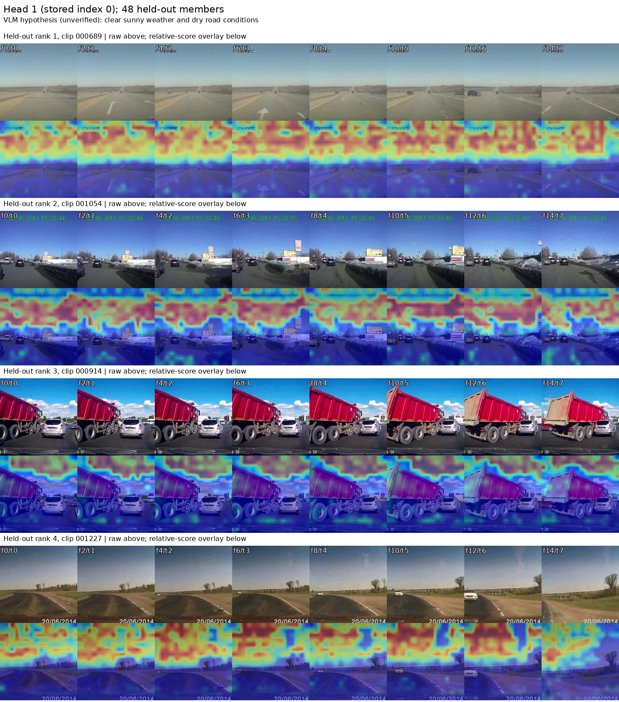
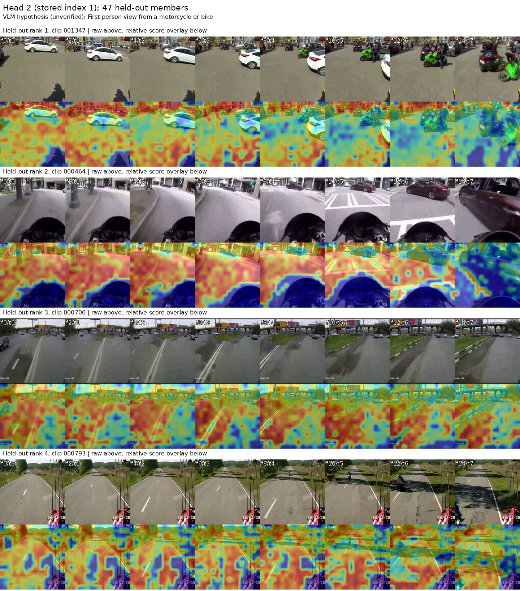
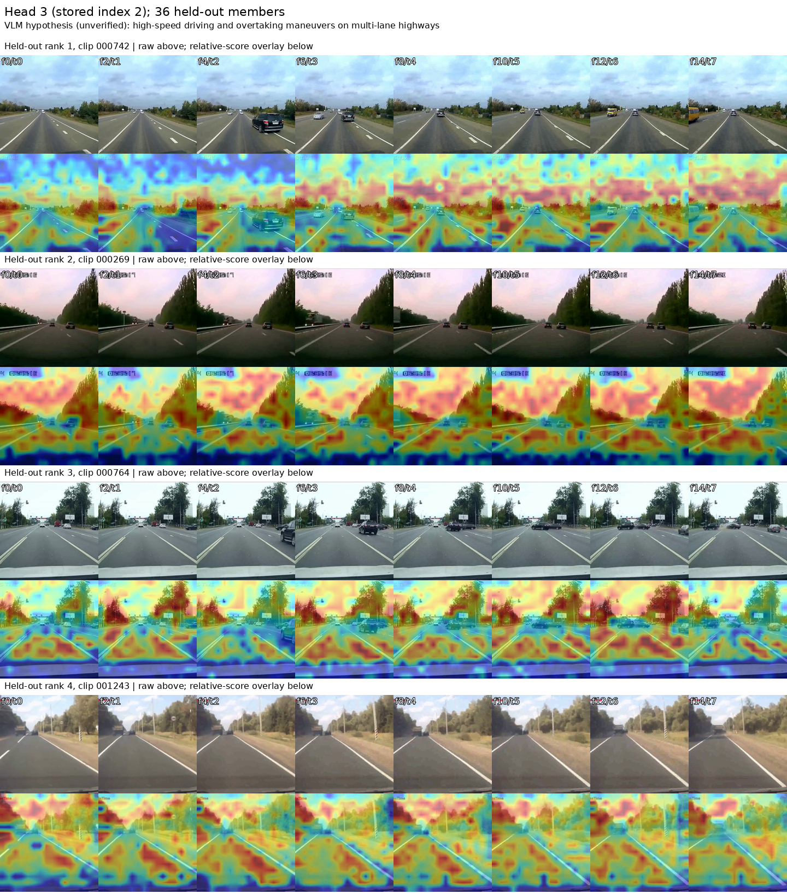
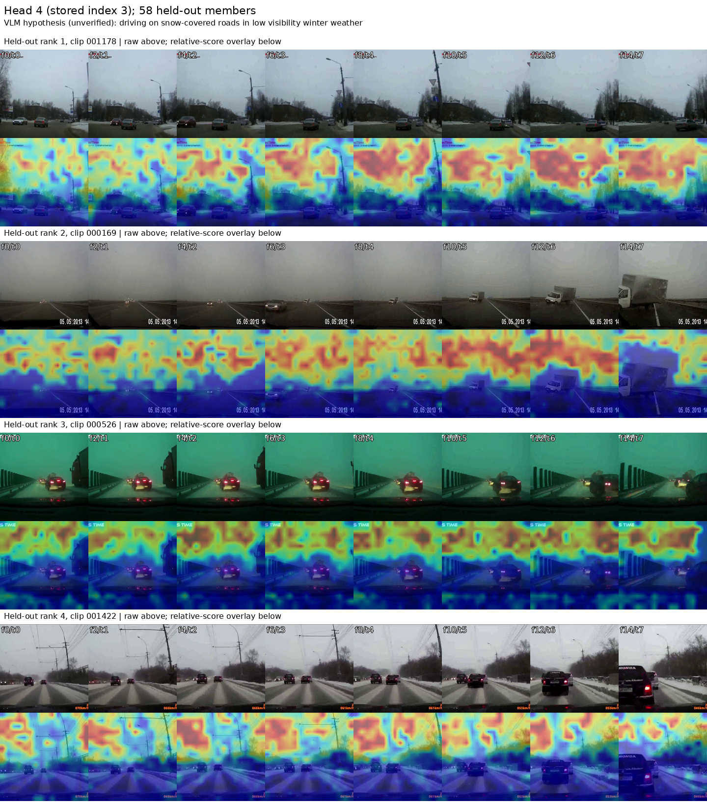
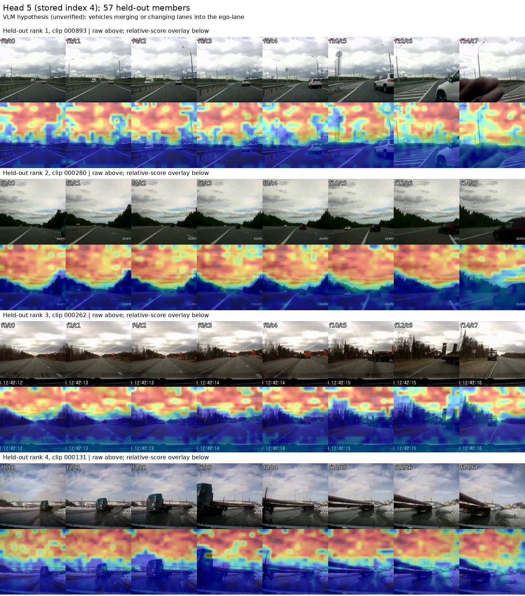
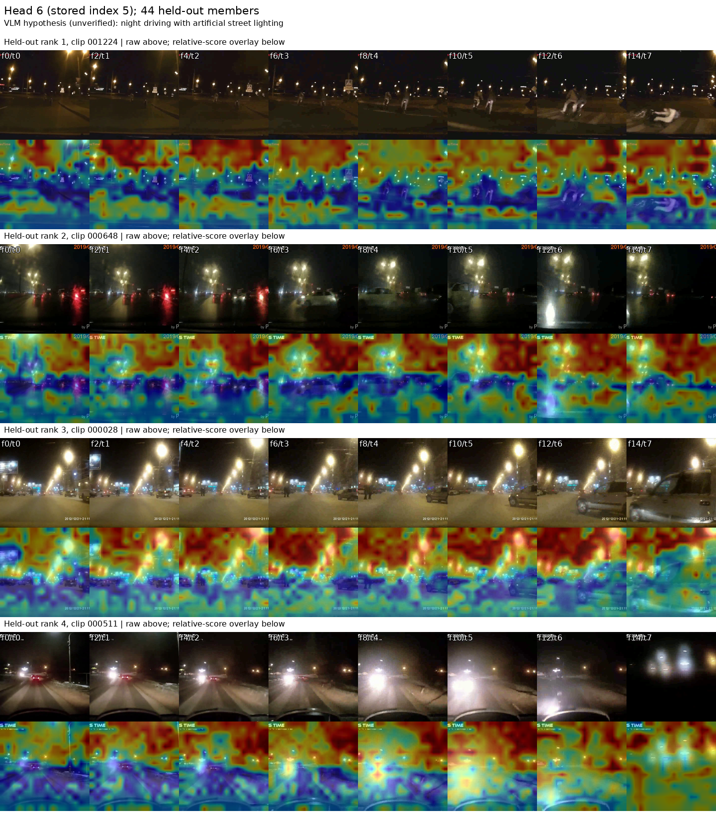

# Rebuttal to Reviewer xYSe

We thank the reviewer for their thoughtful evaluation and for highlighting our clean task formulation, the asymmetric multiple-instance design, and our experiment results. We appreciate your constructive feedback regarding the driving concepts, evaluation metrics, DCBench filtering, and concept budget $K$. We supplement this rebuttal with additional experiments to answer the questions. In the text below, Q1 & W1, refer to Question #1 and Weakness #1 respectively.

## Q1 & W1: Additional Autonomous Driving Crash Concepts

We have uploaded examples for all six discovered concepts at the anonymized link. As shown in the legend of Figure 7 (left), the six concepts on the Car Crash Dataset are (1) Sunny, dry roads, (2) Motorcycle rider view, (3) Highway overtaking, (4) Snowy roads, (5) Lane intrusion, and (6) Night driving. While two of these capture weather and lighting conditions (Snowy roads, Night driving) and one reflects camera perspective (Motorcycle rider view), Concepts 3 and 5 group clips with dynamic traffic interactions (Highway overtaking and Lane intrusion). We believe these discovered differences address the main motivation from the Introduction of finding crash concepts that differ from normal driving.

Our comment in Section 4.4 that these groups do not isolate distinct collision mechanisms was about the failure of the base V-JEPA 2.1 model which is known to struggle with fine-grained motion and intuitive physics (https://arxiv.org/abs/2512.06232), and not a failure of the method itself. We apologize if our phrasing gave the impression that the method failed on this task, and we will make this clearer in the final draft.

Following the reviewer's suggestion, we also tested our method with two new video backbones (matched at $K=6$) to see if other models extract finer-grained crash concepts. As shown in the table below, across all tested backbones, V-JEPA 2.1 still remains the best choice among them all. We believe with better and newer backbones these results will improve further.

| Video Backbone ($K=6$) | cEER ↓ | Act ↑ | Cov ↑ | ΔCoh ↑ | Stab ↑ |
|---|---:|---:|---:|---:|---:|
| EmbeddingGemma 2 | 0.0003 ± 0.0002 | 1.00 | 1.00 | 0.0617 ± 0.0191 | 0.181 |
| VideoMAE V2-Giant | 0.0000 | 1.00 | 1.00 | 0.0859 ± 0.0057 | 0.548 |
| V-JEPA 2.1 (Used In Paper) | 0.0000 ± 0.0001 | 1.00 | 1.00 | 0.1505 ± 0.0080 | 0.383 |

### Examples for all six crash concepts

The following panels use the paper's frozen V-JEPA 2.1 model with $K=6$, seed 0, and 16 frames sampled at 4 fps. Each panel shows the four highest-scoring held-out clips assigned to that concept. For each clip, the raw frames appear above their localization overlays, with time progressing from left to right. Eight frames are displayed: frames 0, 2, 4, 6, 8, 10, 12, and 14, one from each two-frame temporal token.

The overlays show concept-relative patch scores, not gradient-based Grad-CAM. The saved descriptive labels are hypotheses for interpreting the retrieved examples; the visualizations do not independently establish causal collision mechanisms.

#### Concept 1: Sunny, dry roads

*Figure R1. Sunny, dry roads. Each pair of rows shows one held-out clip: raw frames above and localization overlays below.*

#### Concept 2: Motorcycle rider view

*Figure R2. Motorcycle rider view. Each pair of rows shows one held-out clip: raw frames above and localization overlays below.*

#### Concept 3: Highway overtaking

*Figure R3. Highway overtaking. Each pair of rows shows one held-out clip: raw frames above and localization overlays below.*

#### Concept 4: Snowy roads

*Figure R4. Snowy roads. Each pair of rows shows one held-out clip: raw frames above and localization overlays below.*

#### Concept 5: Lane intrusion

*Figure R5. Lane intrusion. Each pair of rows shows one held-out clip: raw frames above and localization overlays below.*

#### Concept 6: Night driving

*Figure R6. Night driving. Each pair of rows shows one held-out clip: raw frames above and localization overlays below.*

## Q2 & W5: Unfiltered DCBench Evaluation

We apologize for the confusing wording on Line 456. That sentence should have stated that in the majority of omitted DCBench problems, less than 50% of the annotated ground-truth slice was misclassified (meaning the classifier actually got most of the slice right). Since our setup compares a model's errors ($A$) against its correct predictions ($B$), a slice that the model mostly gets right sits in the reference set $B$ rather than the error set $A$. We used the 70% misclassification filter in Table 4 simply to ensure that the ground-truth slices we evaluate on are genuine error modes concentrated in $A$. We will fix this in the final version.

To answer the reviewer's question on the unfiltered benchmark, we evaluated all 520 DCBench CelebA problems ($K=5$, 3 seeds) without the 70% filter and presented the results below. Specifically, we see that even in the unfiltered setting, ConceptDiff finds better slices (0.650 Slice AP) with more discriminative features (0.208 cEER) compared to Domino (0.537 Slice AP, 0.249 cEER). While frozen $k$-means gets a slightly higher unfiltered Slice AP (0.662), it clusters raw image features without separating $A$ from $B$, failing to find discriminative features (0.269 cEER). We will include these findings in the final version.

| Method | Filtered (142 problems) Slice AP ↑ | Filtered (142 problems) cEER ↓ | Unfiltered (All problems) Slice AP ↑ | Unfiltered (All problems) cEER ↓ |
|---|---:|---:|---:|---:|
| Frozen k-means | 0.742 | 0.309 | 0.662 | 0.268 |
| Domino | 0.718 | 0.162 | 0.537 | 0.249 |
| ConceptDiff (ours) | 0.807 | 0.169 | 0.650 | 0.208 |

## Q3 & W6: Selecting K and cPCA Baseline

For using ConceptDiff in the real world, we believe $K$ to be a user-defined parameter whose role is to find and group data based on differences. Intuitively, if $K$ is very large (for instance, equal to the size of dataset $A$), then each datapoint will be assigned to a new group since every datapoint has its own difference, which is why we keep $K$ small. That said, when the number of differences is unknown, we believe the best way to pick $K$ is to go with the highest cross-seed stability on the validation set. We tried this approach on our image benchmark, where we know the ideal $K$ is 3. Across different values of $K$, we see that $K = 3$ gives the best stability (0.522) and group recovery (0.460 ARI), while for larger $K$, all heads remain active (Act = 1.00) and split the main groups into finer sub-concepts as separation continues to improve (cEER drops from 0.062 to 0.047). Here are the results:

| Concept Budget ($K$) | ARI ↑ | cEER ↓ | Act ↑ | Cov ↑ | Stab ↑ |
|---|---:|---:|---:|---:|---:|
| $K = 2$ | 0.326 ± 0.018 | 0.074 | 1.00 | 0.823 | 0.339 |
| $K = 3$ (Ideal K) | 0.460 ± 0.020 | 0.062 | 1.00 | 0.827 | 0.522 |
| $K = 4$ | 0.343 ± 0.022 | 0.055 | 1.00 | 0.811 | 0.430 |
| $K = 6$ | 0.246 ± 0.016 | 0.047 | 1.00 | 0.795 | 0.358 |

In addition to that, we also tested Contrastive PCA (cPCA) on the 12 image benchmarks ($K=3$) and saw that ConceptDiff works substantially better in both group recovery and separation. Since cPCA only captures global linear directions over pooled features rather than localized token-level concepts, we tried two forms of grouping, one based on the top-$K$ directions and the other using $k$-means on the cPCA features. In comparison to both cases, ConceptDiff performed much better.

| Method ($K = 3$, 12 Image Tasks) | ARI ↑ | cEER ↓ | Act ↑ | Cov ↑ | Stab ↑ |
|---|---:|---:|---:|---:|---:|
| cPCA (top-K directions) | 0.198 | 0.161 | 1.00 | 0.599 | 1.0* |
| cPCA + k-means | 0.267 | 0.212 | 1.00 | 0.196 | 0.999 |
| ConceptDiff (ours) | 0.460 | 0.062 | 1.00 | 0.827 | 0.522 |

\* Directions are deterministic.

## Q4: Use Of Foundation Models For Evaluation

We would like to clarify that ConceptDiff does not use a foundation model to generate or discover concepts. The foundation model (explainer and simulator) is only used as a post-hoc evaluation metric to measure monosemanticity.

In the introduction, our critique is about methods like VisDiff that rely on an LLM or VLM in the discovery loop to propose candidate differences. ConceptDiff instead discovers the groups and highlights the relevant tokens or patches directly from the data. To evaluate monosemanticity across our experiments, we directly followed the standard explainer-simulator protocol used by [1, 2] as a scalable replacement for human evaluation. In actual deployment, a user does not need the explainer model at all and can simply inspect the top-activating examples and highlighted regions directly.

For our evaluations, we used Gemini 3.1 Pro Preview for both the explainer and simulator roles. We apologize for missing the model name, and we will add this detail to the final version.

## W3: Multi-Objective Metric Trade-offs

The reviewer is right that in our contrastive concept discovery setup, no single metric tells the full story in isolation because baselines often optimize one property at the expense of another. For example, frozen k-means has very high stability (0.990 on images and 0.981 on video) simply because clustering frozen features without contrastive supervision is nearly deterministic, yet it fails to capture the actual differences between datasets (ARI of 0.189 vs. our 0.460, and coverage of 0.395 vs. our 0.827). Conversely, classifier-based baselines like k-means (cls.), HypotheSAEs (cls.), and ProtoSumm can post a low cEER on active heads because their MLP is already trained to classify A vs. B, yet they either collapse onto 1 to 2 heads (Act = 0.22 on crash video) or lose stability and monosemanticity (on EditLens, k-means (cls.) has 0.257 stability and 0.456 simulation vs. our 0.927 and 0.670).

Across all benchmarks, ConceptDiff is the only method that keeps all heads active (Act = 1.00) with high coverage while simultaneously achieving strong separation, stability, and monosemanticity. That is what we intended to convey in the abstract, and we appreciate the reviewer pointing out that our wording could be read as claiming the best score on every individual metric in isolation. We will refine the sentence in the abstract to clearly state that ConceptDiff achieves the strongest overall balance across discriminability, coverage, active concept utilization, and monosemanticity without suffering from concept collapse.

## W4: Use Of Frozen Token Encoders

The reviewer brings up a fair point on terminology. When we wrote "without a foundation model in the loop," we meant that we do not query a generative LLM or VLM during discovery to propose text hypotheses (as in VisDiff and TextDiff), not that we train from raw data without a feature extractor.

Modern pipelines across vision, text, and video are natively token-based. We intentionally designed ConceptDiff as a lightweight, plug-and-play module that attaches to any existing frozen encoder to understand how the backbone interprets data and use that to mark differences. Unlike LLM-in-the-loop baselines, which require thousands of expensive VLM/LLM calls and can only find differences the language model thinks to verbalize, ConceptDiff learns the differences directly from the contrastive token geometry in minutes. We appreciate the reviewer pointing out this ambiguity, and we will update the phrasing in the Abstract and Introduction to "without a generative LLM/VLM hypothesis proposer in the discovery loop" so the distinction is immediately clear.

## References

[1] Bills, et al., "Language models can explain neurons in language models", 2023.

[2] Movva, Rajiv, et al. "Sparse autoencoders for hypothesis generation." arXiv preprint arXiv:2502.04382 (2025).
